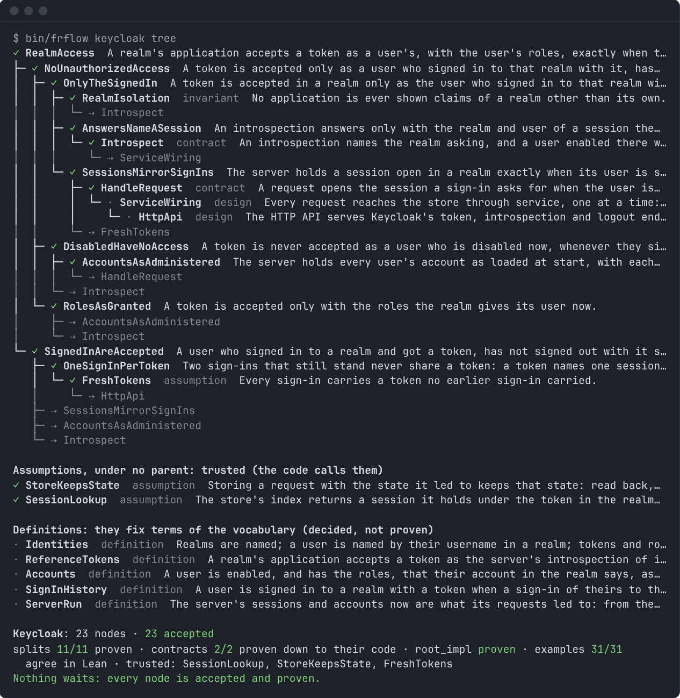
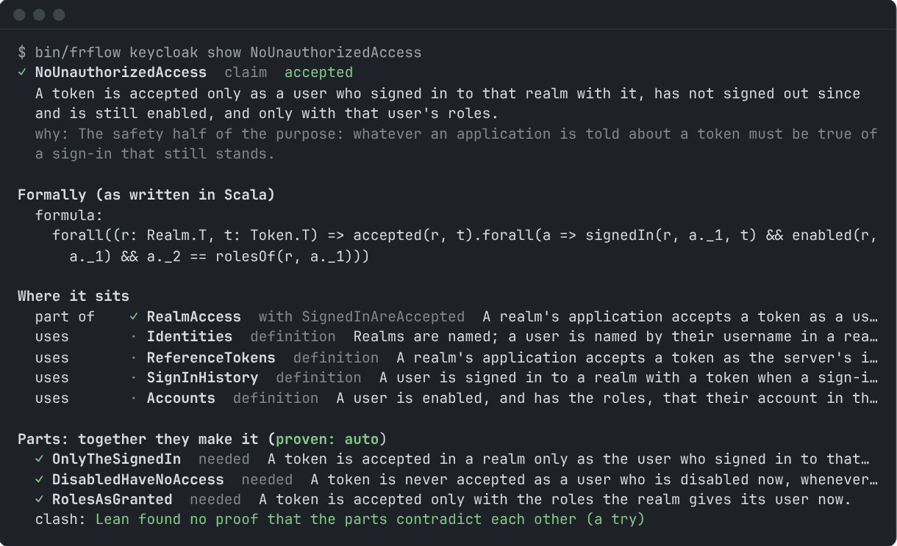
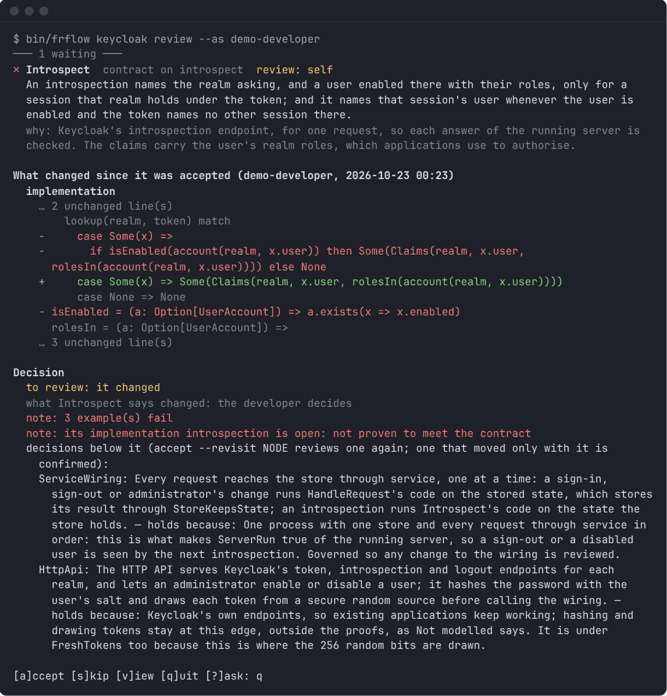
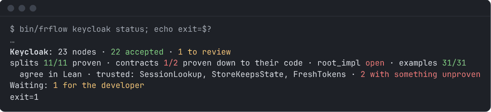
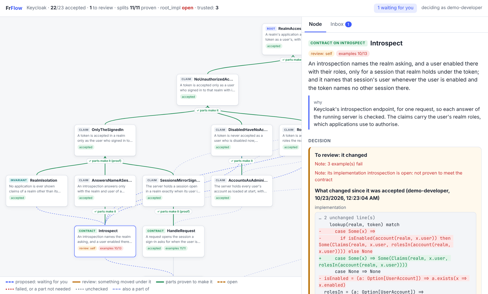

# FrFlow

FrFlow is a Scala 3 library for building software together with a formal model of it, proven in Lean 4.

## The opportunity and the problem with agentic coding

Coding with agentic AI has massively changed software engineering. By using it, developers can explore the solution
space much faster, and build products at much higher velocity.

However, the massive volume of generated code and the nature of agentic coding introduce new challenges. This library,
inspired by the *Future of Programming* talk (Nada Amin, Scala Days 2026), identifies two core issues that introduce
significant risk and cost to the new, agentic software engineering process. Namely:

1. **Lost theory.** Peter Naur argued that a program is the visible part of a theory its programmers hold: why it is
   built the way it is, and how it maps to the world. When agents write the code, nobody on the team builds that
   theory. The agent loses it too, when its context ends. A system nobody understands cannot be changed safely.

2. **Increasing entropy.** A codebase that grows in size without proper tracking of its content and architecture
   suffers from a lack of integrity, which may eventually cause inconsistencies, and even fundamental bugs or security
   vulnerabilities.

## Proposed solution

FrFlow proposes a way to build a formal, logically proven model of the developed software as a refinement tree. It
follows the method of stepwise refinement (Wirth, 1971) and the refinement calculus (Back, 1978; Morgan, 1990):

1. Development starts from a specification: a set of core, formal statements about the program.
2. Then, gradually, each specification is refined. A refinement step replaces a statement with more concrete
   statements that together imply it. Every refinement step is a proof obligation, and Lean checks it, so a statement
   can never contradict the one it refines, and parallel statements are checked against the invariants they share.
3. The final refinement is the program's code itself. At that level, it can be developed in one of two ways:
   - As a standard Scala function or service, with a set of required property-based tests, whose shape and data are
     driven by its formally defined contract.
   - As an implementation in FrFlow's monadic DSL, which compiles both to executable code and to a Lean model, which
     is then used in a strict proof.

The logical model sits alongside the code that performs the given functions, and acts as its contract: an interface
the code conforms to, albeit stricter and more powerful than has been usual for software.

Normally, developing formal proofs for the functions of software would be a costly and inefficient way to verify and
define software. However, with coding agents, this approach of thorough formal software verification has become viable
and should be explored.

## How FrFlow addresses problems of agentic coding

In essence, FrFlow makes sure that there is a view of the software that is correct by construction. The refinement tree
is the source of truth, and it is meant to be impossible to diverge from at the functional level.

Every refinement step is proven in Lean, from the contract of a single function up to the core statements at the
root. When the code meets its contracts, the core statements hold as well. Nobody has to take it on trust that a check
somewhere deep in the code really gives the property stated at the top.

This addresses both problems. The tree, with the reason written next to each statement, is the theory of the program,
and it stays in the repository after the agent's context ends. And every change to the code or to a statement brings
the statements it affects back to the developer for review, with the diff, so the codebase cannot drift away from its
specification unnoticed.

**That makes it possible for a human developer to realistically take responsibility and sign off on mission-critical
software, even if its parts are developed by agentic AI.**

The value of FrFlow is not limited to agentic coding, and it does not need to be used with AI. I encourage the exercise
of building software with this approach, as it makes it much easier to achieve confidence about the quality of the
developed software.

## A small app, step by step

Let's build the booking of meeting rooms. People ask for a room for some time, and a room can hold only one meeting
at a time. The whole example is in [`examples/rooms`](examples/rooms).

**1. What we want.** A booking is a room with a start and an end time. `granted` is the operation we will implement.
It is a `Param`: statements can talk about it before it has code.

```scala
final case class Booking(room: String, start: BigInt, end: BigInt)

val granted =
  Param[(List[Booking], Booking) => Boolean]("granted", "whether a request is granted, given the bookings held")
```

We say what we want in terms of moments. A booking covers every moment from its start up to its end. A room is free
for a request when no booking of that room covers any moment the request covers.

```scala
val covers = define { (b: Term[Booking], t: Term[BigInt]) => b.start <= t && t < b.end }

val freeFor = define { (held: Term[List[Booking]], request: Term[Booking]) =>
  forall((t: Term[BigInt]) => covers(request, t) ==> !held.exists(b => b.room === request.room && covers(b, t)))
}
```

A `define` is written with FrFlow's terms (`Term`, `===`, `==>`, `forall`; `b.start` is the field of the booking
term), so it can be printed as Lean, and run as Scala where its quantifiers allow.

The claim is about inputs that make sense: every booking ends after it starts, no booking is held twice, and any two
bookings held are apart, in different rooms or sharing no moment.

```scala
val endsAfterStart = define { (b: Term[Booking]) => b.start < b.end }
val heldOnce = define { (held: Term[List[Booking]], b: Term[Booking]) => held.filter(x => x === b).length === 1 }

val apart = define { (a: Term[Booking], b: Term[Booking]) =>
  a.room =!= b.room || forall((t: Term[BigInt]) => !(covers(a, t) && covers(b, t))) }

val sensible = define { (held: Term[List[Booking]], request: Term[Booking]) =>
  (request :: held).forall(b => endsAfterStart(b)) &&
  held.forall(b => heldOnce(held, b)) &&
  held.forall(a => held.forall(b => a === b || apart(a, b))) }

val grantWhenFree = Node.claim("GrantWhenFree",
  "A request is granted exactly when its room is free for its whole time.",
  why = "Refusing a free room wastes it, and granting a taken one double-books it."
)(forall((held: Term[List[Booking]], request: Term[Booking]) =>
  sensible(held, request) ==> (granted(held, request) === freeFor(held, request))))
```

The developer accepts or rejects each statement with `bin/frflow rooms review`, and each decision is signed (step 6).

**2. A contract the code can meet.** The claim speaks of moments; code compares start and end times. We refine the
claim into a contract on `granted` stated in those terms. A claim is any statement; a contract
is a statement about every call of one operation. Its examples are calls: an `expect` gives a call and the result it
must have, a `reject` a result it must never have.

```scala
val overlaps = define { (a: Term[Booking], b: Term[Booking]) =>
  a.room === b.room && a.start < b.end && b.start < a.end }

val consistent = define { (held: Term[List[Booking]], request: Term[Booking]) =>
  (request :: held).forall(b => endsAfterStart(b)) &&
  held.forall(b => heldOnce(held, b)) &&
  held.forall(a => held.forall(b => a === b || !overlaps(a, b))) }

val grantWhenNoOverlap = Node.contract(granted)("GrantWhenNoOverlap",
  "A request is granted exactly when it overlaps no booking of its room.",
  why = "Bookings that end after they start share a moment exactly when they overlap."
)((held, request, result) => consistent(held, request) ==> (result === !held.exists(b => overlaps(b, request))))
  .under(grantWhenFree)
  .examples(
    expect(List(Booking("Oak", 9, 10)), Booking("Oak", 10, 11), true, "back to back: granted"),
    reject(List(Booking("Oak", 9, 11)), Booking("Oak", 10, 12), true, "overlapping: never granted"))
```

`consistent` is `sensible` with `!overlaps` in place of `apart`, so it has no quantifier over moments, and code and
tests can evaluate it. `.under` says the contract refines `GrantWhenFree`: Lean must prove that whatever meets the
contract meets the claim, using that `sensible` gives `consistent`. FrFlow also asks Lean to prove that the parts
contradict each other, which would make the step hold for no reason, and reports it if Lean can; failing to prove it
does not show they are consistent. What Lean proves is the Lean that FrFlow prints from these definitions, so that
printing is trusted; the examples cross-check it by running the same definitions as Scala. The
[proof](examples/rooms/lean/Proofs/Rooms/GrantWhenFree.lean) is 24 lines of Lean. When FrFlow is used with an agent,
the agent writes it; `check` has Lean check it, and refuses a proof left unfinished (`sorry`) or one that adds an
axiom.

**3. The code.** The calendar keeps each room's bookings in start order, finds the request's place by binary search,
and compares it with the bookings on either side:

```scala
final class Calendar(bookings: List[Booking]):
  private val byRoom = bookings.groupBy(_.room).view.mapValues(_.sortBy(_.start).toVector).toMap

  def granted(request: Booking): Boolean =
    val room = byRoom.getOrElse(request.room, Vector.empty)
    val next = room.search(request)(using Ordering.by(_.start)).insertionPoint
    room.lift(next - 1).forall(_.end <= request.start) && room.lift(next).forall(_.start >= request.end)

val knowledge = KnowledgeBase("Rooms")(grantWhenFree, grantWhenNoOverlap)
  .implement(grantWhenNoOverlap)((held, request) => Calendar(held).granted(request))
```

`.implement` attaches the code to the contract. `bin/frflow rooms check` runs it on the examples and on 1,000
generated inputs. The inputs come from nine lines of FrFlow `Gen` generators in the example, which build consistent
calendars, some with back-to-back bookings. Each test builds a calendar from its input; a service would keep one.
`check` takes about 3 seconds when nothing changed, and up to 20 when a change needs compiling and new proofs.

**4. When the code is wrong.** Suppose we forget the booking after the request:

```diff
-    room.lift(next - 1).forall(_.end <= request.start) && room.lift(next).forall(_.start >= request.end)
+    room.lift(next - 1).forall(_.end <= request.start)
```

`check` finds an input where the code breaks the contract (`x` marks a failure, `+` a pass):

```
+ GrantWhenFree: step proven
x GrantWhenNoOverlap: failed
  its code fails a generated case: held = List(Booking("Oak", 0, 4)), request = Booking("Oak", 0, 1): returned true, which GrantWhenNoOverlap refuses
```

Oak is booked from 0 to 4, and a request for 0 to 1 was granted. A good property test would find this too. While the
code fails, FrFlow does not let the developer accept the change.

**5. When the agent misreads the requirement.** Suppose the agent takes meetings that touch to be overlapping, and
writes the contract, the code and the examples from that reading:

```scala
val overlaps = define { (a: Term[Booking], b: Term[Booking]) =>
  a.room === b.room && a.start <= b.end && b.start <= a.end }

// GrantWhenNoOverlap's examples
  .examples(
    expect(List(Booking("Oak", 9, 10)), Booking("Oak", 11, 12), true, "a gap between them: granted"),
    expect(List(Booking("Oak", 9, 10)), Booking("Oak", 10, 11), false, "back to back: refused"),
    reject(List(Booking("Oak", 9, 11)), Booking("Oak", 10, 12), true, "overlapping: never granted"))

// Calendar.granted
    room.lift(next - 1).forall(_.end < request.start) && room.lift(next).forall(_.start > request.end)
```

Everything below the claim agrees with itself, so every test passes. The claim above it does not agree, and `check`
shows a case, which Lean confirms (`o` marks a step that does not hold, `!` what to do):

```
o GrantWhenFree: the step from its parts does not hold: held = List(Booking("Elm", 2, 4)), request = Booking("Elm", 0, 2): the contract refuses it, and the claim needs it granted
    Lean proves the step false on it
  ! check the change to overlaps: with it, the contract no longer gives the claim
+ GrantWhenNoOverlap: code tested on 1,000 cases
```

A request from 0 to 2 and a booking from 2 to 4 share no moment, so the room is free. (The misread `consistent` also
leaves calendars with back-to-back bookings outside the contract, so fewer generated cases test anything.) An example
written by a person ("back to back: granted") would also catch this; when the agent writes the examples from the same
misreading, the claim it was refined from catches it.

**6. When the misreading reaches the claim.** Suppose the agent also changes `covers` to include the end moment, and
adjusts everything below so that Lean proves the step again. Then `check` passes, and the claim comes back to the
developer instead (`review: self`: the claim itself changed), with what changed since it was accepted:

```
+ GrantWhenFree  claim (the root)  review: self
What changed since it was accepted (demo-developer, 2026-10-26 12:37)
  definitions used
    - covers = (b: Term[Booking], t: Term[BigInt]) => b.start <= t && t < b.end
    + covers = (b: Term[Booking], t: Term[BigInt]) => b.start <= t && t <= b.end
```

The claim's sentence has not changed, but its meaning has, and the diff shows where: one `<` became `<=`. The claim is
in the words of the domain, which makes it the place to review. A decision counts only when it verifies against the
public key committed under the developer's name. The public keys are committed like any other file, and FrFlow trusts
only the committed versions. The private key stays outside the repository; an agent that cannot read it cannot accept
the changed claim as the developer, so the agent should run where it cannot.

This example decides a single request, for a calendar that is already sensible. Storing the bookings so that it
stays sensible, and two people booking one room at the same moment, are further refinements;
[`examples/sharing`](examples/sharing) shows how FrFlow models stored state and concurrent requests.

## Statements

There are six kinds of statements:

| Kind | What it says | How it is checked |
|---|---|---|
| claim | a property of the system, in the words of its domain | Lean proves it from the statements that refine it |
| definition | what a term of the domain means in this system | decided by the developer |
| contract | what every call of an operation returns | Lean proves the statements above from it; the code below is proven or tested against it |
| assumption | what an outside system, such as a database, does | decided by the developer, and checked at run time |
| invariant | a rule that every operation in its scope keeps | Lean, for every contract in its scope |
| design | an architecture decision with no formal content | decided by the developer; a change to the code it covers brings it back |

A statement can refine several others, so the tree is in fact a directed acyclic graph with one root.

## Proven, tested and assumed

The code at the bottom of the tree is in one of three states, and `status` reports which:

- **Proven** code is written in the DSL, and Lean proves that it meets its contract.
- **Tested** code is plain Scala. It is tested against its contract on generated cases, and checked on every call at
  run time.
- **Assumed** code is an outside system, such as a database or the clock. Its behaviour is an assumption the developer
  decides, and it is checked at run time and against its model on generated runs.

Everything above the code is proven from these. What is left to trust is the assumptions the developer accepted,
FrFlow's translation of the model to Lean (which the examples cross-check by running the same model as Scala), and,
for tested code, the inputs the tests and run-time checks actually reach.

## Decisions

The developer accepts or rejects every statement, in the terminal or in a local web view. Each decision is signed with
the developer's key and kept in a ledger in the repository. When anything a decision rests on changes, the statement
comes back for review with the diff. `status` exits with 1 while anything waits for a decision or is not proven, so CI
can gate on it.

## Using it

`bin/frflow PROJECT COMMAND` runs the command line of a project. The screenshots below are from `examples/keycloak`.

`tree` shows the graph from the root, with the state and the kind of each statement.



`show NODE` shows one statement: what it says and why, its formula, where it sits, and the statements that refine it,
with what Lean proved.



`review` goes through the statements waiting for a decision, each with what changed. Here, the check that the user is
still enabled was removed from the introspection code, so three examples fail and the proof of the code no longer goes
through.



`check` renders the model as Lean and proves it, and `status` shows the state of the whole project.



`sbt "PROJECT/serve --as NAME"` runs the same flow as a local web view, with the graph, the statement under review and
its diff, and the inbox. Decisions are signed the same way as in the terminal.



## With an AI agent

The agent layer (`modules/agent`) is enabled per project with `extensions = List(frflow.agent.Agent)`. The developer
describes the idea to the agent, which asks what it needs to know, proposes the root and its refinements, writes the
proofs and the code, and answers the developer's questions about any statement. The decisions stay with the developer.
The agent's rules are in [`.claude/skills/frflow/SKILL.md`](.claude/skills/frflow/SKILL.md).

## Getting started

You need JDK 17 or later, sbt, and Lean 4.35.0 installed with [elan](https://github.com/leanprover/elan), so that
`lake` is on the `PATH`.

```sh
git clone https://github.com/szymon-rd/fr-flow && cd fr-flow
bin/frflow auth tree                    # the smallest example; compiles on first use
bin/frflow keycloak check               # prove the keycloak example in Lean
bin/frflow keycloak show RealmAccess    # read its root
sbt "keycloak/serve --as NAME"          # the web view on localhost, deciding as NAME
```

`sbt "frflowInit NAME"` creates an empty project in `examples/NAME`, and `sbt "frflowInitAgent NAME"` creates one with
the agent layer enabled.

## Examples

- `examples/rooms` books meeting rooms: the example above.
- `examples/auth` is access control by a table of grants, and the smallest example.
- `examples/keycloak` has realms, sign-in, token introspection and sign-out over HTTP. Its sessions are proven to
  follow the history of requests.
- `examples/crm` is a multi-tenant CRM on SQLite with an HTTP API. Its expiry job is a flow over the database, proven
  from the database's model.
- `examples/sharing` shares documents, folders and teams between people, with expiring shares, invitations, a trash,
  access requests, notifications and an audit log. Time, failures and concurrency are modelled.

## References

- Nada Amin, [*Future of Programming*](https://scaladays.org/session/future-of-programming/), keynote at Scala Days
  2026.
- Peter Naur, *Programming as Theory Building* (1985).
- Niklaus Wirth, *Program Development by Stepwise Refinement*, Communications of the ACM 14(4), 1971.
- Ralph-Johan Back, *On the Correctness of Refinement Steps in Program Development*, PhD thesis, University of
  Helsinki, 1978; and Ralph-Johan Back and Joakim von Wright, *Refinement Calculus: A Systematic Introduction* (1998).
- Carroll Morgan, *Programming from Specifications* (1990).
- Eric Evans, *Domain-Driven Design* (2003).
- Leonardo de Moura and Sebastian Ullrich, *The Lean 4 Theorem Prover and Programming Language* (2021).

## Documentation

- [docs/index.html](docs/index.html) has a tutorial, how-to guides, the reference and troubleshooting.
- [docs/USAGE.md](docs/USAGE.md) describes the commands, their output and exit codes, what Lean proves, the warnings,
  the web view and the modules.
- [docs/DAG.md](docs/DAG.md) describes the design of the refinement graph.
