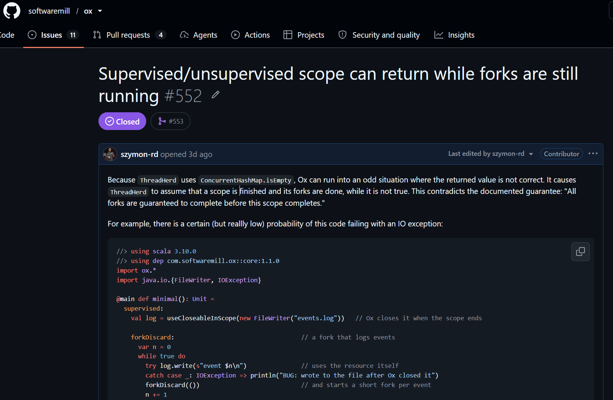

## A month ago, at ScalaDays

- Nada Amin's talk: **Future of programming**
- The opportunities and issues of agentic coding

## Risks of agentic coding

- Increasing entropy (analysis vs synthesis)
- Lost ownership (lost theory)
- Issues with software quality

## Those are not new problems

Remember the times before AI?

- When we were talking about legacy, confusing code bases...
- When taking ownership was one of the most important skills...
- When good testing practices were hard to come by...

## How we dealt with those issues before AI

As engineers, we developed a culture that kept our work to high standards:

- Testing, ownership, review processes, requirements tracking
- That gave us confidence and understanding.

## Trap of AI

- AI makes it possible to execute our vision much faster.
- AI *seems* to take responsibility for the code.
- We always look for ways to avoid the discomfort of intellectual struggle.

## It is us, not the AI

- AI is a tool. Ownership cannot be delegated to it.
- The problems come from us giving up ownership and understanding.
- Our workflows and culture have to change so that we keep both.

## What are we missing

- **A record of the understanding** we used to build by writing the code ourselves.
- **A way to track requirements**, and to know the software meets them.

## Proposed tool: Formal modeling framework for Scala

Let's imagine we can build a complete, formal view of the software that:

- **Is compiled from the code itself**, so it can never drift from it.
- **Is an ordinary Scala value**, so we can query it and build on it.
- **Holds our formal requirements** and proves them against the code.

## How could we build a model like that? {.center}

## Step 1: Build the claims tree

Write a **tree of formal statements** about components of software, analogously to requirements.

1. *Tree roots* are formalized requirements about the general idea of the project.
2. *Lower nodes* explain properties of modules and subcomponents.
3. *Leaves* directly describe properties of code.

## Logical relations in the tree

1. Children of a node together must imply their parent.
2. Children of a node cannot contradict one another.
3. There must exist a system that fulfills a level of the tree (*non-vacuity*).

## Step 2: Generate the model for a theorem prover

1. Generate the tree of claims as theorems in Rocq.
2. **Compile the entire relevant Scala code to Rocq.**
3. Generate or write (with an LLM) the proofs:
   - Of leaf nodes, directly from the Scala compiled to the Rocq model.
   - Of parent nodes, from their children.

## Step 3: Operate on the model

Use the built model to:

- Reason about functional correctness of the code.
- See the purpose of each part of the code:
  - If code is used in some proof, it serves the purpose of that requirement.
  - If code is used in no proof, it is detached from the requirements tree.

## How this solves issues with agentic coding

- Quality:
  - Very high confidence in formal correctness of software, with respect to the signed-off requirements.
- Responsibility:
  - Developer signs off on requirements.
  - Developer is sure of the functional relevance of AI-generated code.
- Entropy:
  - Claim tree assigns code to the requirements, by using it in proofs.

## FrFlow is an implementation of that flow

```{dot}
//| fig-width: 10
//| fig-height: 4
digraph frflow {
  rankdir=LR;
  bgcolor="transparent";
  nodesep=0.6;
  ranksep=0.9;
  node [shape=box, style="rounded,filled", fontname="Jost", fontsize=16,
        margin="0.25,0.18", color="#2a76dd", fillcolor="#eaf2fd", penwidth=1.5];
  edge [color="#555555", penwidth=1.5, arrowsize=0.9];

  claims [label="Logical claims"];
  code   [label="Code representation\nin Rocq"];
  model  [label="Rocq model\nand proofs"];
  view   [label="Logical view\nof software", fillcolor="#2a76dd", fontcolor="white"];

  claims -> model;
  code   -> model;
  model  -> view;
}
```

## Example of formally specified service: URL Shortener {.code-columns}

:::: {.columns}

::: {.column width="44%"}
The service:

```scala
trait Links extends Mutable:

  update def shorten(url: Url): Code

  def resolve(code: Code): Option[Url]

  update def remove(code: Code): Unit
```
:::

::: {.column width="56%"}
In the companion object:

```scala
object Links:
  val shortener = Declaration[Links](
    "The link shortener")

  val shortenIsIdempotent = Node.claim(
    "URL shortener is idempotent")(
    forall((u: Term[Url]) =>
      shortener.shorten(u).isIdempotent))

  val shortenedCodeResolves = Node.claim(
    "The code a URL is given leads to that URL.")(
    forall((u: Term[Url]) => shortener.shorten(u).andThen(
      code => shortener.resolve(code)) === some(u)))

  // etc.
```
:::

::::

## Implementation {.code-mid}

```scala
final class RetiringLinks(var issued: List[Link], var retired: List[Code]) extends Links:
  update def shorten(url: Url): Code =
    val held = issued
    val known = held.find(
        l => Issued.leadsTo(held, l.code) == Some(url)
    ).map(l => l.code)
    val code = known.getOrElse(Code(Issued.above(held, retired)))
    if known.isEmpty then issued = Link(code, url) :: held
    code

  def resolve(code: Code): Option[Url] = Issued.leadsTo(issued, code)

  update def remove(code: Code): Unit =
    issued = issued.filter(l => l.code != code)
    retired = code :: retired
```

## Composing the model

```scala
val links: FrModel = FrModel("Shortener")(
  Links.claims,
  Links.shortener.define(lifted[RetiringLinks]))
```

## Actual refinement flow {.center}

## 1. Start with the root statements {.code-wide}

```scala
val linkLeadsUntilRemoved = Node.claim("A link leads to its URL until it is removed.")(
  forall((code: Term[Code], url: Term[Url], later: shortener.History) =>
    val link = shortener.resolve(code)
    ((link === some(url)) && later.never(shortener.remove(code))) implies
      (link.following(later) === some(url))))

val shortenedCodeResolves = Node.claim("The code a URL is given leads to that URL.")(
  forall((url: Term[Url]) =>
    shortener.shorten(url).andThen(code => shortener.resolve(code)) === some(url)))

val removedLinkStaysRemoved = Node.claim("A removed link never leads anywhere again.")(
  forall((code: Term[Code], later: shortener.History) =>
    shortener.resolve(code).following(shortener.remove(code)).following(later).isEmpty))

val shortenIsIdempotent = Node.claim(
  "Shortening a URL again gives the same link and changes nothing.")(
  forall((url: Term[Url]) => shortener.shorten(url).isIdempotent))
```

## 2. Refine statements down to the code {.code-wide}

(Or let AI do that for you)

```scala
// What the members do: each claim is proven of the class.
val removedCodeNotReissued = Node.claim("A removed code is never given to a URL again.")(
  forall((code: Term[Code], url: Term[Url], later: shortener.History) =>
    shortener.shorten(url).following(shortener.remove(code)).following(later) =!= code))

val shortenChangesOnlyItsCode = Node.claim(
  "Shortening a URL changes where no code leads but the one it gives.")(
  forall((url: Term[Url], other: Term[Code]) =>
    (other =!= shortener.shorten(url).result) implies
      shortener.resolve(other).unchangedBy(shortener.shorten(url))))

// Each is placed under the root it helps prove; the class gives the service its meaning.
val fullShortener: FrModel = FrModel("FullShortener")(
  removedLinkStaysRemoved,
  Links.removedCodeLeadsNowhere.refines(removedLinkStaysRemoved),
  Links.removedCodeNotReissued.refines(removedLinkStaysRemoved),
  Links.shortenChangesOnlyItsCode.refines(removedLinkStaysRemoved),
  Links.removeKeepsOtherCodes.refines(linkLeadsUntilRemoved, removedLinkStaysRemoved),
  // ... the other roots and their parts
  Links.shortener.define(lifted[RetiringLinks]))
```

## 3. Generate the model… {.code-wide}

The root, as FrFlow generates it in Rocq (reformatted): every list of later calls, each a URL shortened or a code removed.

```coq
Definition removedLinkStaysRemoved_claim
    shortener_resolve shortener_shorten shortener_remove : Prop :=
  forall (shortener : Links) (code : Code) (later : list (Except Url Code)),
    match shortener_resolve
      (List_foldl (fun state call => match call with
                                     | Except_error given => snd (shortener_shorten state given)
                                     | Except_ok other => snd (shortener_remove state other)
                                     end)
        (snd (shortener_remove shortener code)) later) code
    with None => True | Some a => False end.
```

## 3. …and prove it {.code-wide}

Its proof, from the four claims below it, by induction over the later calls:

```coq
Lemma removedLinkStaysRemoved_Proofs_impl : removedLinkStaysRemoved_Obl_impl.
Proof.
  unfold removedLinkStaysRemoved_Obl_impl, removedLinkStaysRemoved_claim,
    removeKeepsOtherCodes_claim, removedCodeLeadsNowhere_claim,
    removedCodeNotReissued_claim, shortenChangesOnlyItsCode_claim.
  intros others nowhere notGiven only s code later.
  induction later as [| call earlier ih] using rev_ind.
  - exact (nowhere s code).
  - rewrite List_foldl_app. rewrite List_foldl_cons. rewrite List_foldl_nil.
    destruct call as [given | other].
    + rewrite only; [exact ih |].
      intros e. apply (notGiven s code given earlier). symmetry. exact e.
    + destruct (classic (other = code)) as [e | e].
      * subst other. apply nowhere.
      * rewrite others; [exact ih | exact e].
Qed.
```

## 4. Review the claims tree {background-color="#12151a"}


## Trace claim to code {background-color="#12151a"}


## FrFlow architecture

```{dot}
//| fig-width: 10
//| fig-height: 3.3
digraph architecture {
  rankdir=LR;
  bgcolor="transparent";
  nodesep=0.45;
  ranksep=0.35;
  node [fontname="Jost", fontsize=18, margin="0.14,0.1", penwidth=1.5];
  edge [color="#555555", penwidth=1.5, arrowsize=0.9];

  // What is read: pages.
  node [shape=note, style="filled", color="#888888", fillcolor="#ffffff"];
  claims  [group=main,  label=<<b>Claims</b><br/><font point-size="14">in the Scala DSL</font>>];
  classes [group=below, label=<<b>Classes</b><br/><font point-size="14">compiled Scala</font>>];
  proofs  [label=<<b>Proofs</b><br/><font point-size="14">tactics, LLM, by hand</font>>];

  // What does the work: boxes.
  node [shape=box, style="rounded,filled", color="#2a76dd", fillcolor="#eaf2fd"];
  elaborate [group=main,  label=<<b>Elaboration</b><br/><font point-size="14">claims to formulas</font>>];
  compiler  [group=below, label=<<b>Scala compiler</b><br/><font point-size="14">classes to terms</font>>];
  printer   [group=main,  label=<<b>Rocq printer</b><br/><font point-size="14">writes the theorems</font>>];
  rocq      [group=main,  label=<<b>Rocq</b><br/><font point-size="14">checks every proof</font>>, color="#c98a00", fillcolor="#fff4d6"];
  view      [group=main,  label=<<b>Web view, CLI</b><br/><font point-size="14">a verdict per node</font>>];

  { rank=same; claims; classes; }
  { rank=same; elaborate; compiler; }
  { rank=same; rocq; proofs; }

  claims -> elaborate -> printer -> rocq -> view [weight=10];
  classes -> compiler [weight=10];
  compiler -> printer;
  proofs -> rocq;
}
```

## Real use case: Ox's structured concurrency

- A library for structured concurrency in Scala.
- Claim: A scope starts forks, and must not end before them.

## What it took

- Ox compiled to Rocq.
- A semantics and assumptions of the JVM in Rocq.
- A DSL to describe "any trace of JVM execution".

## What was proven*

After `supervised` or `unsupervised` has completed:

- No fork of the scope runs.
- No thread is added or started.
- Forking in that scope is refused.
- No data race on the scope's fields.

## What it found {background-color="#0d1117"}



## Future I would like {.center}

